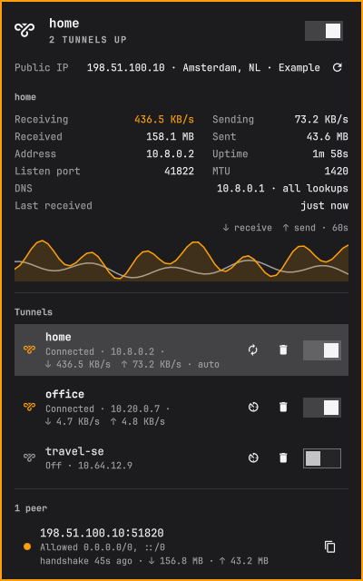

# WireGuard for Omarchy

A bar widget for [Omarchy](https://omarchy.org/) that shows your WireGuard tunnels' status, live speed and traffic stats, and peer handshakes, with one-click toggles.

> Community project. Not affiliated with or endorsed by WireGuard or Jason A. Donenfeld.



<sub>Screenshot uses example data (documentation IP ranges).</sub>

## Install

```bash
omarchy plugin add https://github.com/tsmithscott/omarchy-wireguard.git --enable
```

Requirements: Omarchy with shell plugin support, NetworkManager (Omarchy's default), `wireguard-tools` for `wg`/`wg-quick`, and `curl`.

## Features

- **Bar:** VPN icon, slashed when nothing is up, with a `!` badge when a peer stops handshaking. Optional label showing the tunnel name or live ↓/↑ speed. The hover tooltip shows the active tunnels and their speeds.
  Left click opens the panel, right click runs the master toggle, middle click refreshes.
- **Panel:** a master switch, plus for the selected tunnel: live receive/send rate, total received/sent, address, uptime, listen port, MTU, time since data was last received, and a 60-second throughput graph. Your public exit IP (with city and provider) is shown at the top and refreshes automatically. Every tunnel has its own switch, an autoconnect toggle, and a remove button (with confirmation; Delete key too). Removing a NetworkManager tunnel deletes its profile; removing a wg-quick entry just hides it, since `/etc/wireguard` is root-owned. Peers show their endpoint and allowed IPs, plus handshake age and per-peer traffic when peer stats are on. The panel also has "Import config" (a file chooser, then `nmcli connection import`).
- **Settings:** a collapsible Settings section at the bottom of the panel covers bar label, default tunnel, automatic public IP, graph, one-tunnel-at-a-time, notifications, peer-stats button, hidden interfaces, and wg-quick configs. Omarchy has no settings screen for plugins, so they live in the panel. They're saved to this widget's entry in `~/.config/omarchy/shell.json`, so `omarchy bar set tsmithscott.wireguard <key> <value>` works too.
- **Keys:** j/k or arrows move (the panel scrolls to follow), Enter toggles the tunnel or runs the button under the cursor (including opening Settings), Delete removes, Esc closes, `t` master toggle, `c` copy address, `i` import, `p` public IP, `r` refresh.

## Multiple tunnels

Split tunnels (peers that only route specific networks) run side by side. A full tunnel, one that routes all traffic (`0.0.0.0/0` or `::/0`, or the `/1` halves), can't share the default route with another full tunnel. So bringing one up disconnects any other full tunnel for the same address family, and a notification says which one went down. Turn on "One tunnel at a time" in Settings to have every connect disconnect all the others.

## Tunnel sources

| Kind | Where from | Toggle |
|---|---|---|
| NetworkManager | saved `wireguard` profiles | `nmcli connection up/down`, no root |
| wg-quick | names listed in the `wgQuickConfigs` setting | `pkexec wg-quick up/down` |
| unmanaged | any other live WireGuard interface | read-only |

`wt0` (NetBird) is hidden by default via `excludeInterfaces`.

## Peer stats (optional)

The kernel only shows handshake times and per-peer counters to root. "Enable peer stats" runs
`pkexec bin/setup-peer-stats $USER`, which installs:

- `/usr/local/bin/omarchy-wg-dump`, a wrapper around `wg show all dump` that replaces every private and preshared key with `(hidden)`
- `/etc/sudoers.d/omarchy-wg-dump`, which lets you run only that wrapper, with no arguments, without a password and without filling the journal

Undo: `pkexec ~/.config/omarchy/plugins/tsmithscott.wireguard/bin/setup-peer-stats --remove`

If either path already holds a file the plugin didn't install, setup stops without changing anything (see [Files outside your home directory](#files-outside-your-home-directory)).

## IPC

```
omarchy-shell tsmithscott.wireguard status | toggleAll | up <name> | down <name> | refresh | open
```

## Network access

The plugin makes one kind of network request: an HTTPS GET to `https://ipinfo.io/json` to look up your public IP (6s timeout, 4 KB cap, response validated). It runs when the panel opens (at most once a minute) and a couple of seconds after any tunnel goes up or down. Turn off "Look up public IP automatically" in the panel's Settings section and it only runs when you click ↻.

## Without peer stats

Connection health still works without the root helper. If a tunnel with keepalive set receives nothing for 3 minutes, the icon gets the `!` badge, because with keepalive WireGuard re-handshakes about every 2 minutes. Only the exact per-peer handshake time and per-peer byte counts need the helper.

## Tests

`node test/model.test.js` and `bash test/system-files.test.sh`

## Tunnel DNS

`omarchy dns` (Cloudflare/Google/Custom) writes a NetworkManager `[global-dns]` block, and while that block exists NetworkManager ignores every connection's own DNS. A tunnel's `DNS =` line is silently dropped. The panel's DNS row shows whether the tunnel's servers are actually in use, and **Fix tunnel DNS** (one password prompt) installs `bin/tunnel-dns-dispatcher` as `/etc/NetworkManager/dispatcher.d/90-omarchy-wireguard-dns`. When a WireGuard profile comes up, the hook sets that link's DNS in systemd-resolved, the way wg-quick does:

- **Which lookups use the tunnel:** if the profile's search domains include `~domain` entries, only lookups for those domains go through the tunnel (split DNS). Otherwise `~.` sends every lookup through the tunnel while it's up, so nothing leaks to the system DNS.
- **Several tunnels at once:** see below.
- **DNS-over-TLS** is turned off for the tunnel link, because tunnel resolvers rarely support it.
- **Re-applied automatically** whenever a WireGuard tunnel goes up, goes down or is reapplied, and on NetworkManager's `dns-change` event, in case NetworkManager rewrites the link.

Your system DNS choice is untouched and still applies whenever no tunnel is up. The hook works for `nmcli connection up` too, not only the plugin.

Undo: `pkexec ~/.config/omarchy/plugins/tsmithscott.wireguard/bin/setup-tunnel-dns --remove`

If something else is already installed at that path, the plugin leaves it in place and doesn't offer the fix.

If you installed the hook from an older version of the plugin, the panel offers **Update DNS hook** (one password prompt) so it follows the Tunnel DNS setting.

### Several tunnels with DNS

When two connected tunnels both take every lookup (both have `~.`), systemd-resolved doesn't pick one. It sends each lookup to both and uses whichever answers first, so a name that only one tunnel's resolver knows can still come back "not found" from the other. The panel says when this is happening.

**Settings → Tunnel DNS** picks one tunnel to answer every lookup while it's connected. The others then answer only their own `~domain` routing and search domains. **Automatic** goes back to asking them all. A split-DNS tunnel (one with its own `~domain` entries) isn't on the list, because it never takes every lookup.

The choice is stored in the NetworkManager profile as `ipv4.dns-priority` and `ipv6.dns-priority` = `-50`, NetworkManager's own "use only this connection's DNS" setting. So it holds whether or not `omarchy dns` is set, and from `nmcli connection up` too. wg-quick tunnels set their own DNS through resolvconf and aren't affected.

## Uninstalling

The peer-stats helper and the tunnel-DNS hook are root-owned copies outside the plugin folder, so `omarchy plugin remove` doesn't remove them. Remove them first, with one password prompt:

```
pkexec ~/.config/omarchy/plugins/tsmithscott.wireguard/bin/uninstall-system-files
```

That removes `/etc/NetworkManager/dispatcher.d/90-omarchy-wireguard-dns`, `/usr/local/bin/omarchy-wg-dump`, and `/etc/sudoers.d/omarchy-wg-dump`, but only the ones the plugin installed. Your imported tunnels are NetworkManager profiles and stay until you delete them.

## Files outside your home directory

The plugin only replaces or deletes a file at the three paths above if it can tell it installed that file: a regular, root-owned file (not a symlink) that either carries the line `# omarchy-plugin-file: tsmithscott.wireguard` or matches, byte for byte, a file an earlier version installed. Anything else there, such as an administrator's own hook or sudoers rule, is left in place. Setup reports it and stops, and uninstall says it skipped it. The checks are in `bin/system-files.bash`.
